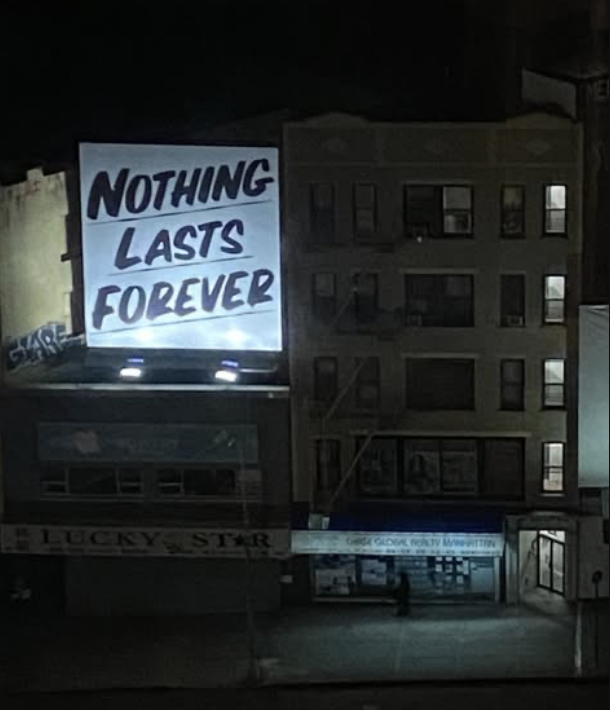

# i crave imperfection

**mannequin · (mqn) · @sammypandolfi**

[Enter the website](https://pandol.fi/) · [@icraveimperfection](https://instagram.com/icraveimperfection)

A nighttime street, held still. Two lamps illuminate a fabric sign above the storefronts. A cut loosens the cloth, exposes its backing, and changes the shadow. Farther down the building, an open doorway leads to the work on Instagram.

The homepage is this photograph. No visible menu, captions, or controls interrupt it. The camera never moves; the motion belongs to the fabric and the light.



## Inside the photograph

| Gesture | What happens |
| --- | --- |
| Swipe or drag across the sign | Cut the fabric along the stroke. Loose edges bend and pieces fall. |
| Press the doorway or its threshold | The existing doorway light brightens immediately. |
| Release inside the doorway's touch area | Open Instagram in the same tab. |
| Slide outside that area before releasing | Cancel the visit. Moving back inside does not undo the cancellation. |
| Reload | Restore the uncut sign. |

The doorway's invisible touch area extends beyond the narrow opening, making it forgiving on a phone. Its glow follows the exposed jamb and interior light, leaving the opaque, half-open door leaf dark. Hover and keyboard focus also bring up the light.

A lower corner of the sign lifts, catches the lamps, and settles once per tab session. Touching the fabric interrupts the invitation. Cut pieces fade into the dark foreground before reaching the photograph's edge; the canvas is also clipped to the image. There is no accumulating pile of scraps.

Two fixed lights reproduce the lamps below the sign. Their shadows respond to the torn geometry against a charcoal backing. Occasionally, paired, overlapping beams from an unseen passing car cross the whole facade, storefront, and pavement. The moving light briefly picks out folds and throws longer shadows before the street returns to its original exposure.

The first headlight pass starts after 12–18 seconds. A pass lasts 5.2 seconds, followed by 70–110 seconds of quiet. The former [`/light/` preview](https://pandol.fi/light/) now shows the same scene as the homepage.

## Phones, access, and stillness

The scene fits inside a fixed viewport. One-finger cutting gestures cannot drag the document down or trigger pull-to-refresh; two-finger zoom remains available. Empty space around the photograph stays dark.

The sign and doorway have accessible names and keyboard interaction. Focus the sign and press **Enter** or **Space** to cut across its middle, or **R** to repair it. Focus the doorway and press **Enter** to visit Instagram.

With reduced motion enabled, or when WebGL cannot start, the original photograph and the real doorway link remain. The photograph and link are also present without JavaScript. Animation pauses while the tab is hidden, and the rendering loop rests between interactions and light passes. Cuts live only in memory; session storage remembers whether the corner invitation has played.

## Working on it

Use **Node.js 22**, matching the publishing workflow.

```sh
npm ci
npm run dev
```

Open the local address printed by Next.js, normally `http://localhost:3000`.

| Command | Purpose |
| --- | --- |
| `npm run dev` | Local development with live updates. |
| `npm run typecheck` | Generate route types and check TypeScript. |
| `npm run lint` | Run ESLint. |
| `npm run build` | Create a production build using the current environment. |
| `npm run verify` | Run type checking, linting, and the production build in sequence. |

The site uses Next.js, React, TypeScript, and Three.js. Production is a static export: no application server or private credentials are shipped to the browser.

### Where things live

| File or directory | Role |
| --- | --- |
| `src/app/page.tsx` | The public homepage. |
| `public/study/nothing-lasts-forever.png` | The source photograph, 610 × 710 pixels. |
| `src/components/study/Billboard.tsx` | Scene assembly, image alignment, input, and animation lifecycle. |
| `src/components/study/billboard-physics.ts` | Cloth constraints, cuts, loose pieces, and the corner invitation. |
| `src/components/study/relighting.ts` | Cloth illumination, backing, and projected shadows. |
| `src/components/study/headlight-wash.ts` | Paired headlight wash across the photographed architecture. |
| `src/components/study/passing-headlights.ts` | Timing and travel of the passing light. |
| `src/components/study/DoorLink.tsx` | Doorway hit area, press feedback, cancellation, and navigation. |
| `src/components/study/DoorSpill.tsx` | Doorway light on the pavement. |
| `src/components/study/PhotoViewport.tsx` | Mobile viewport and gesture handling. |
| `content/site.ts` | Identity, Instagram handle, and site address. |
| `.github/workflows/pages.yml` | Verification, static export, and GitHub Pages deployment. |

The sign corners, doorway opening, occluding door leaf, and light masks are mapped to this particular photograph. Replacing the image also requires aligning that geometry; changing the filename alone is not enough.

Earlier portfolio pages remain at `/work/`, `/work/[slug]/`, and `/about/`. Their copy lives in `content/about.md` and `content/work/*.md`, with photographs under `public/work/`. They are not linked from the photographic homepage. Some older profile fields are still explicit placeholders. `BRIEF.md` and `DECISIONS.md` record earlier design directions; this README describes the current public scene.

## Publishing

Push to `main`. The **Publish website** workflow installs locked dependencies, runs `npm run verify`, packages `out/`, and deploys through GitHub Pages. A failed verification stops the deployment. The workflow can also be run manually from [Actions](https://github.com/dimerize/pandolfi/actions/workflows/pages.yml).

Pages must use **GitHub Actions** as its build source. The workflow reads the site's base path and address from Pages. The custom domain serves assets and routes at the root, with no `/pandolfi` prefix. To reproduce that build locally:

```sh
STATIC_EXPORT=true NEXT_PUBLIC_BASE_PATH='' NEXT_PUBLIC_SITE_URL=https://pandol.fi npm run verify
```

For a static preview at a local server's root instead:

```sh
STATIC_EXPORT=true NEXT_PUBLIC_BASE_PATH='' NEXT_PUBLIC_SITE_URL=http://localhost:8080 npm run verify
python3 -m http.server 8080 --directory out
```

`npm run start` serves a normal Next.js server build; use a static file server for `out/`.

## Domain

**The active address is [pandol.fi](https://pandol.fi/).** GitHub Pages enforces HTTPS. `www.pandol.fi` and the original `dimerize.github.io/pandolfi/` address redirect to the custom domain.

The domain is registered through Netim. Its DNS records are:

| Name | Type | Value |
| --- | --- | --- |
| `@` | `A` | `185.199.108.153`, `185.199.109.153`, `185.199.110.153`, `185.199.111.153` (four records) |
| `@` | `AAAA` | `2606:50c0:8000::153`, `2606:50c0:8001::153`, `2606:50c0:8002::153`, `2606:50c0:8003::153` (four records) |
| `www` | `CNAME` | `dimerize.github.io` |

Netim's nameservers are `ns1.netim.net`, `ns2.netim.net`, and `ns3.netim.net`; their delegation is published in the `.fi` registry.

For future hosting changes:

1. Keep the custom domain set to `pandol.fi` in the repository's Pages settings and keep **Enforce HTTPS** enabled. This Actions-based deployment does not need a `CNAME` file.
2. Rerun the publishing workflow after changing the Pages domain or HTTPS setting so asset paths and site metadata match the active address.
3. Verify public DNS, certificate validity, images, scripts, cuts, the doorway link, and the redirects from the original address and `www`.
4. If a domain change needs to be rolled back, clear the custom-domain setting and rerun the workflow to restore `/pandolfi/`. A cached redirect may require a fresh URL query or browser cache refresh.

See [GitHub's custom-domain documentation](https://docs.github.com/en/pages/configuring-a-custom-domain-for-your-github-pages-site/managing-a-custom-domain-for-your-github-pages-site) and [Netim's nameserver documentation](https://support.netim.com/en/docs/general-public/domain-name/managing-dns-nameservers) for the hosting details.
